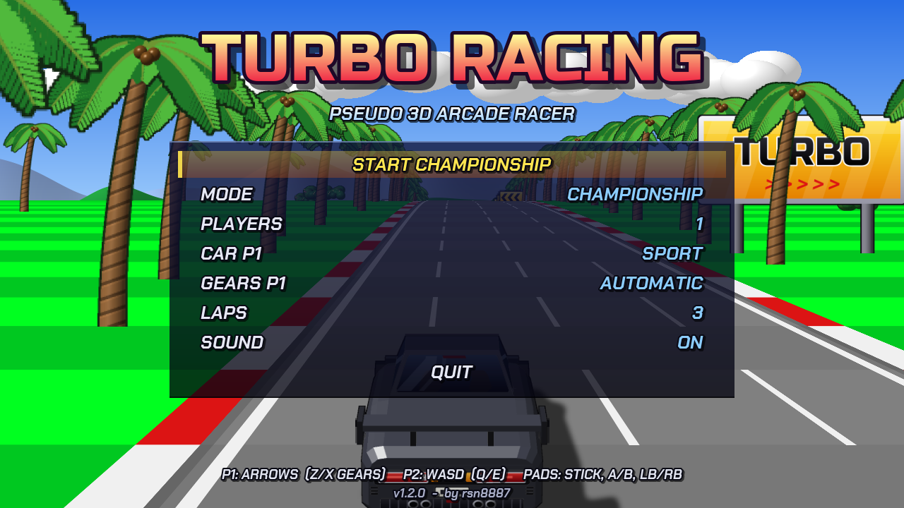
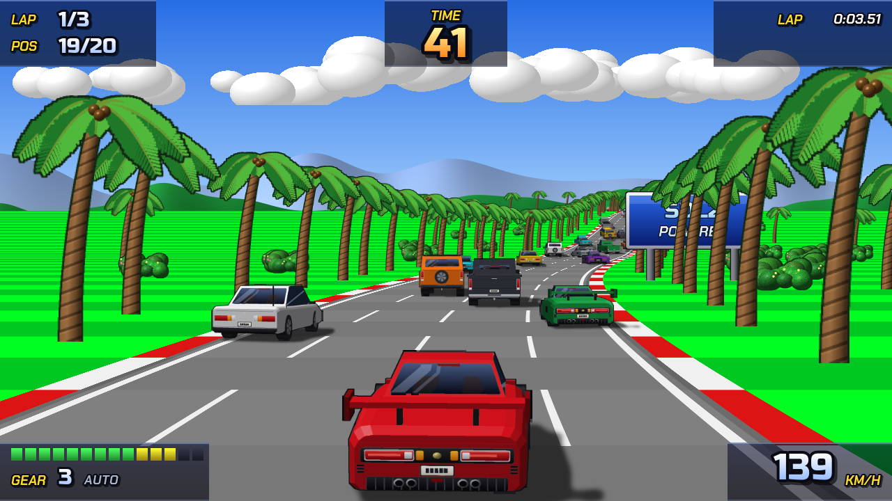

# Turbo Racing

A pseudo-3D arcade racer in the style of Outrun and Lotus Esprit Turbo Challenge, written in C++17 with SDL2. It has 11 stages (from a palm-lined coast to a chequerboard road in a sci-fi city, a rainbow road in Rio, Paris, the Autobahn and Florence), 6 car types, 20 cars per race, championship and single-race modes, and 2-player split screen.





## Controls

| Action | Player 1 | Player 2 | Controller |
|---|---|---|---|
| Steer | ← → | A D | Left stick / D-pad |
| Accelerate | ↑ | W | A or right trigger |
| Brake | ↓ | S | B or left trigger |
| Gear up / down (manual) | X / Z | E / Q | RB / LB |
| Pause | Esc or P | | Start |

F11 or Alt+Enter toggles fullscreen.

## Building

Needs CMake, SDL2 and SDL2_ttf. The build makes the game (`turboracing`) and the asset tool (`turbo_assetgen`). All builds go into a folder next to the project, so the project folder stays clean: run the commands from the folder that contains the `TurboRacing` folder.

**macOS**
```sh
brew install sdl2 sdl2_ttf cmake
cmake -S TurboRacing -B build && cmake --build build -j
open build/TurboRacing.app
```
To make a `.dmg` for sharing, run `TurboRacing/make_dmg.sh`. It builds into `build-macos/` and puts the SDL libraries into the app, so it runs on Macs without Homebrew. The result is `build-macos/TurboRacing-<version>-macOS-arm64.dmg`. The app is signed ad hoc, so the first time it has to be opened with right-click > Open.

**Linux**
```sh
sudo apt install libsdl2-dev libsdl2-ttf-dev cmake g++
cmake -S TurboRacing -B build && cmake --build build -j
./build/turboracing
```

**Nintendo Switch**
```sh
docker run --rm --platform linux/amd64 -v "$PWD":/src -w /src devkitpro/devkita64 \
  sh -c 'cmake -S ./TurboRacing -B build-switch -DPLATFORM=SWITCH -DCMAKE_TOOLCHAIN_FILE=$DEVKITPRO/cmake/Switch.cmake && cmake --build build-switch -j'
```
This creates `build-switch/turboracing.nro`.

On the Switch:
- Launch the game through title takeover (hold **R** while starting an installed game). The album applet doesn't have enough memory for it.
- For less memory and CPU load, add `-DTURBO_RENDER_SCALE=1` to the first `cmake` command. The game then renders at 640×360.

## Assets

All graphics are PNG atlases in `assets/` and can be edited with any image editor that keeps the alpha channel. Each picture has a 1-pixel magenta (255, 0, 255) frame around it. Its position is listed in the `.txt` file next to the PNG. Car bodies are grey and get recoloured where the matching `_paint.png` mask is white.

`./build/turbo_assetgen TurboRacing/assets` regenerates all assets. **Careful: this overwrites your hand edits.**

The app icons are in `icon/`: `icon_switch.jpg` for the Switch, `TurboRacing.icns` for macOS, and `icon.png` as the 1024×1024 original. `./build/turbo_assetgen --icons TurboRacing/icon` paints them again.

assisted by Claude
